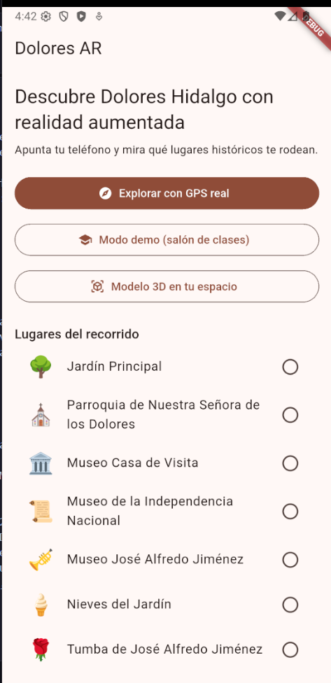
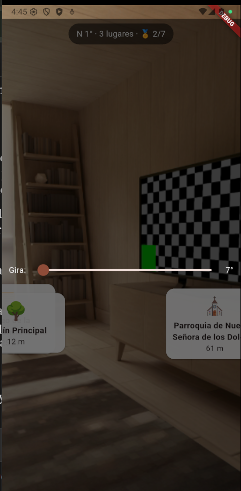
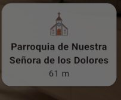
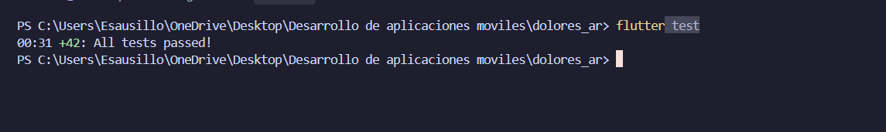
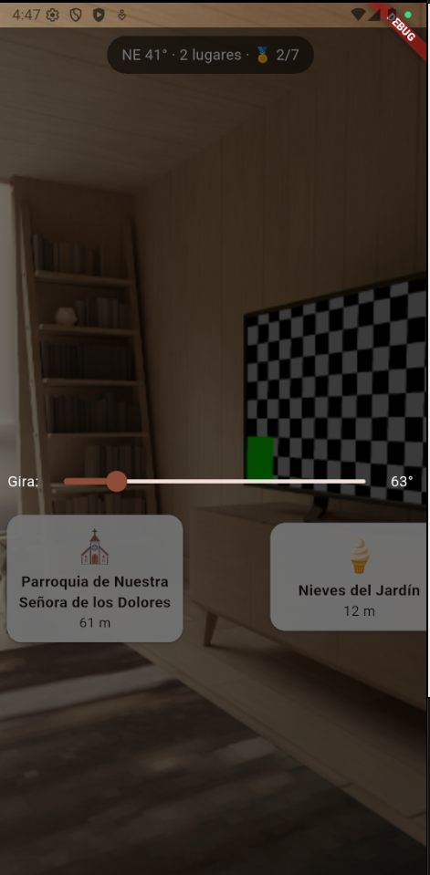

# Dolores AR

App turística con realidad aumentada para visitar Dolores Hidalgo, Guanajuato.
Desarrollada con Flutter y TDD (desarrollo guiado por pruebas).

Proyecto de Desarrollo Móvil Integral · UTNG



## ¿Qué hace?

- **RA por ubicación:** usa GPS, brújula y cámara para mostrar etiquetas flotantes sobre los lugares históricos cercanos, con su distancia.
- **Detalle de cada lugar:** al tocar una etiqueta se abre su descripción y un dato curioso.
- **Pasaporte turístico:** al llegar a menos de 40 m de un lugar se gana un sello.
- **Modo demo:** funciona sin GPS ni brújula, con un deslizador para girar (ideal para el salón de clases).
- **RA de superficie:** coloca un modelo 3D sobre el piso o una mesa (ARCore / Quick Look).




## Lugares del recorrido

Jardín Principal · Parroquia de Nuestra Señora de los Dolores · Museo Casa de Visita · Museo de la Independencia Nacional · Museo José Alfredo Jiménez · Nieves del Jardín · Tumba de José Alfredo Jiménez

> Las coordenadas del catálogo son aproximadas. Se corrigen con una prueba de campo.

## Arquitectura

El proyecto se divide en tres capas:

| Capa | Carpeta | Contenido |
|---|---|---|
| Dominio | `lib/dominio/` | Matemáticas y reglas en Dart puro (sin plugins): distancia, rumbo, ángulos, campo de visión, motor de RA, pasaporte |
| Datos | `lib/datos/` | Fuentes reales (GPS y brújula) y fuentes simuladas (modo demo) |
| Presentación | `lib/presentacion/` | ViewModel y pantallas |

El ViewModel depende de contratos (`FuentePosicion`, `FuenteBrujula`), no de los plugins.
Por eso se puede simular cualquier ubicación y probar sin salir a caminar.

```
lib/
├── main.dart
├── dominio/   geo, lugar, catalogo, motor_ar, pasaporte, fuentes, excepciones
├── datos/     fuentes_reales, fuentes_simuladas
└── presentacion/   ar_viewmodel, fondo_camara, pantalla_ar, pantalla_inicio, pantalla_modelo3d
test/          geo_test, motor_ar_test, pasaporte_test, ar_viewmodel_test, ayudas_geo
```

## Cómo funciona la RA por ubicación

1. Se calcula la **distancia** a cada lugar (fórmula de Haversine).
2. Se calcula el **rumbo** hacia el lugar (0° = norte).
3. Se obtiene la **diferencia angular** entre hacia dónde miras y hacia dónde está el lugar, por el camino corto del círculo (resuelve el salto 359° → 1°).
4. Si cae dentro del **campo de visión** (60°), se convierte en posición horizontal en pantalla.
5. Los lugares lejanos se dibujan más pequeños y más cerca del horizonte.

La brújula se suaviza con un filtro circular para que las etiquetas no tiemblen.

## Pruebas (TDD)

Cada regla se escribió primero como prueba (rojo), luego el código mínimo (verde) y después se ordenó (refactor).

```bash
flutter test
```



## Requisitos

- Flutter 3.x (Dart >= 3.0)
- Teléfono real con GPS, brújula y cámara para el modo GPS real
- Android 7.0+ (`minSdkVersion 24`) o iPhone con iOS reciente

## Instalación

```bash
git clone <URL-DEL-REPOSITORIO>
cd dolores_ar
flutter pub get
flutter run
```

## Permisos

- **Android:** `INTERNET`, `CAMERA`, `ACCESS_FINE_LOCATION`, `ACCESS_COARSE_LOCATION` en `AndroidManifest.xml`.
- **iOS:** `NSCameraUsageDescription` y `NSLocationWhenInUseUsageDescription` en `Info.plist`.

## Uso

1. **Modo demo:** toca "Modo demo (salón de clases)" y mueve el deslizador "Gira" para ver aparecer las etiquetas.
2. **GPS real:** toca "Explorar con GPS real", acepta los permisos y apunta el teléfono hacia los lugares.
3. **Modelo 3D:** toca "Modelo 3D en tu espacio" y luego el ícono de RA.



## Privacidad y seguridad

- Se pide ubicación solo **mientras se usa la app**, nunca en segundo plano.
- Todo el cálculo ocurre en el teléfono: la app **no envía tu ubicación a ningún servidor**.
- Los errores inesperados muestran un mensaje genérico, sin detalles internos.
- **Aviso de seguridad:** mira a tu alrededor, cuida tu paso y no cruces la calle viendo el teléfono.

## Retos pendientes

Guía de audio · persistencia del pasaporte · contenido desde Wikipedia · ruta guiada · anclas reales de RA · versión en inglés · mini mapa

## Autor

<Tu nombre> · <Tu grupo> · UTNG
Prof. Anastacio Rodríguez García